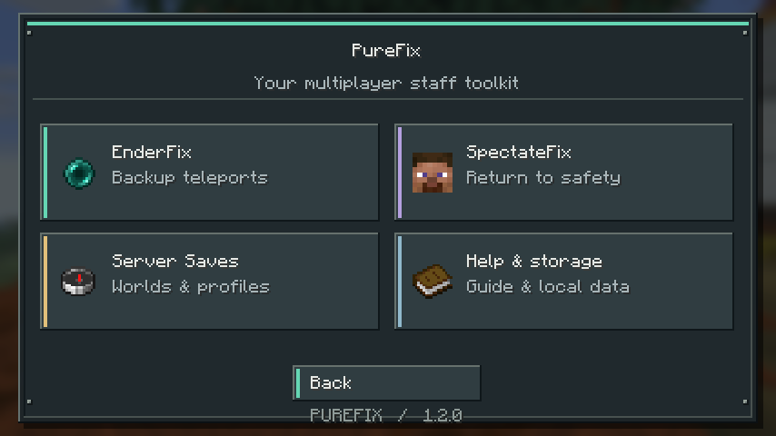

# PureFix

PureFix is an English-only, **client-side Fabric mod for Minecraft Java 26.3**. It helps multiplayer staff teleport from InventoryRollbackPlus backups and recover their position after disconnecting while spectating.



## Installation

1. Install Minecraft **26.3**, Fabric Loader **0.19.5 or newer**, and Java **25 or newer**.
2. Put `purefix-1.2.0.jar` in your Minecraft instance's `mods` folder. Remove the previous PureFix jar when upgrading; keep your configuration folder.
3. Install **Fabric API for 26.3**. This release was built with `0.161.0+26.3`.
4. Install **Mod Menu for 26.3** to access **Mods > PureFix > Configure**. This release was built with Mod Menu `21.0.0`. Mod Menu is optional: `/purefix` also opens the configuration while connected.
5. Connect to your multiplayer server. PureFix is not installed on the server.

The server must already provide CoreProtect and InventoryRollbackPlus and grant your account the relevant command permissions. PureFix sends normal commands using your account; it does not grant permissions or implement either plugin. SpectateFix assumes `/s` and `/spectate` are supplied by your server's staff/spectate plugin.

## Server Saves

**Automatic server capture** is ON by default. PureFix stores the connected address, the server-list display name, a detected subserver identifier, editable subserver name, and dimension-to-Bukkit-world mappings. Display names initially come from the client server list, not the proxy's private configuration.

- **Add Server** captures the current multiplayer address and detected ID and asks for a subserver name. Saving selects that profile for the current connection.
- Open a profile to edit its name, address, or subserver, select it for this connection, edit world mappings, enable/disable automatic recovery, or delete it.
- **Bind to current detected ID** updates a profile after an identifier changes. Only do this while connected to that subserver.
- Deleting a profile suppresses its automatic recapture. **Allow deleted servers to be captured again** resets that suppression for future connections.
- Deleting a profile retains its saved recovery records. Remove those separately with **SpectateFix > Saved returns > Forget** if no longer needed.
- **Export server saves to CSV** writes one row per world mapping to `config/purefix/servers.csv`. CSV is an export, not the authoritative database.

Turning off passive automatic capture stops discovery. **Add Server** remains available. Starting a spectate session may create a return profile when no matching profile exists, because saving the return requires a server identity.

### Proxy networks and identification limits

PureFix prioritizes world IDs received on **`xaeroworldmap:main`**, the Xaero World Map channel supported by MapModCompanion. Xaero World Map does not have to be installed on the client. When it is installed, PureFix observes its packets without replacing its decoder or receiver. No other map channels are registered.

Open **SpectateFix > Check MapModCompanion** while connected to print the current detection result in Minecraft chat. A valid message confirms a compatible world-ID provider, **not the exact plugin name**: other software can send the same protocol. No message does not prove the plugin is absent. This button reports received data; it does not send a plugin-list command or request.

On a previously unknown network, PureFix waits **60 client ticks** (about three seconds) for world data before falling back to the vanilla server-provided obfuscated seed fingerprint. A valid Xaero ID takes priority when it arrives. Once an address has supplied a valid ID, that fact is persisted: future missing IDs keep recovery pending instead of silently downgrading to seed detection. World transitions clear the previous confirmed ID, including transitions with an identical seed. Spectate entry is blocked while identity is unresolved.

The vanilla fallback is a heuristic. Cloned worlds/backends can share an identifier; servers can hide it; regenerated worlds may change it. It does not reveal the private world seed. For hidden or shared fallback identifiers:

1. Use **Add Server** to create each subserver profile and give it a useful name.
2. Use **Use this subserver for this connection** when entering that backend. Selection resets on disconnect, login/respawn, or a changed detected ID. Manual selection cannot override a conflicting Xaero ID.
3. When several profiles have the same address and identifier, PureFix does not automatically choose one. A zero/hidden identifier also requires manual selection before automatic recovery.
4. For a backend whose identity cannot be trusted, turn **Automatic spectate recovery** OFF in its profile until you select the correct backend and enable recovery.

Xaero IDs identify **worlds**, not necessarily whole SMP backends. Different dimensions can have different IDs, and the packet supplies neither a human SMP name nor a Bukkit world name. Profiles are separated by main address and detected ID. A return saved with a Xaero ID waits for **that exact ID**, even if another world belongs to the same SMP. PureFix does not infer that two IDs share a backend, switch servers, or treat a changed inventory as proof of identity. A misconfigured provider that reuses IDs can still cause collisions.

Upgrading preserves existing profiles and returns. Seed profiles are not automatically merged with new Xaero profiles, because matching seeds are not proof of the same world. Use **Bind to current detected ID** only after verifying the world; resolve duplicate profiles manually. PureFix neither reads nor modifies Xaero files. See [design notes](docs/DESIGN.md).

### Bukkit world mappings

Each profile starts with:

| Minecraft dimension | CoreProtect/Bukkit world |
| --- | --- |
| `minecraft:overworld` | `world` |
| `minecraft:the_nether` | `world_nether` |
| `minecraft:the_end` | `world_the_end` |

These are conventional names, not server-verified names. Change them under **World mappings** for renamed worlds, Multiverse worlds, or custom dimensions. Custom dimension IDs must be mapped before spectating. Names must be a single command-safe token; spaces are not supported. A backup pearl supplies its own world name, so EnderFix does not substitute these mappings for the pearl's world.

## EnderFix

Enabled by default, with a small vanilla ender pearl icon and teleport sound.

1. Run `/ir restore <player>`, `/irp restore <player>`, or `/inventoryrollback restore <player>`.
2. PureFix watches for the **Player Data** 9-slot menu. It checks the empty slots and bone, oak sapling, red bed, compass, and diamond; the first slot is deliberately ignored.
3. Navigate to **Main Inventory Backup**.
4. Left- or right-click the teleport pearl in the bottom action row (slot 49, counted from zero).
5. PureFix reads `World:`, `X:`, `Y:`, and `Z:` from the pearl's lore, closes the container, cancels the original inventory click, and sends:

```text
/co teleport #{world} {x} {y} {z}
```

For the supplied screenshot the command is:

```text
/co teleport #world_nether -145.6 128 308.7
```

The screenshot's Z value is **308.7**; it is not rounded to 309. Formatting codes are removed before parsing. Negative and decimal coordinates are supported. Duplicate, missing, nonnumeric, out-of-range, or unsafe fields are rejected. Modified clicks on the recognized action pearl are cancelled to prevent a second plugin action.

**EnderFix settings** include enable/disable, sound, adding/editing/deleting restore command patterns, the teleport command, and exact menu/item recognition titles. All four placeholders `{world}`, `{x}`, `{y}`, `{z}` are required. Literal `x y z` is not a valid template. The lore labels remain English; translated/custom lore layouts need a code adapter.

**Restore command patterns > Reset > Confirm** restores exactly these defaults:

```text
/ir restore {player}
/irp restore {player}
/inventoryrollback restore {player}
```

Upgrading from the untouched 1.0.0 default list adds the new alias automatically. Customized lists are preserved until you explicitly reset them.

The initial menu must appear within two minutes of a recognized command. After it is recognized, the menu chain remains armed for up to ten minutes; closing it disarms detection after a short transition allowance. Opening a backup through an unrelated command or bypassing the initial menu does not arm EnderFix. No ordinary inventory pearl is intercepted.

Vanilla ender pearl teleportation uses the Enderman teleport sound, so EnderFix uses that sound locally when it dispatches the command. Sound is not proof that the server accepted the teleport.

## SpectateFix

Enabled by default, with Enderman teleport sound. Its menu icon uses your current player's skin face while in-game, with Steve as the offline fallback. Menus use vanilla item artwork, pixel borders, colored section accents, and explicit ON/OFF badges.

1. Stand at your return point, for example `world_nether`, `0 90 0`.
2. Run `/s <player>` or `/spectate <player>`.
3. PureFix writes the original position to disk **before sending the command**. If it cannot safely save, it cancels the spectate command and tells you why.
4. PureFix watches server game-mode changes. Once spectator mode has been observed for the saved session, a server change to survival, creative, or adventure clears the return. This also covers the observed player disconnecting when your server responds by returning you to survival. Repeating spectate commands preserves the original position; bare `/s` and `/spectate` pass through without clearing anything.
5. If you disconnect, crash, or close Minecraft before that exit is observed, the return remains on disk. Reconnect to the matching world. PureFix waits for world identification and the initial server position, plus a configurable readiness delay (default **0 ticks**), then sends:

```text
/co teleport #world_nether 0 90 0
```

Return records are separated by **player UUID and server profile**. A new spectate session in the current connection does not immediately trigger recovery. The mod sends at most one automatic attempt per pending return per connection. For automatic recovery, it confirms arrival after a new server position update places the player within two blocks of the stored coordinates in the stored dimension and matching profile. The sound plays when arrival is confirmed. An observed normal exit from spectator mode can also clear a saved session without issuing a recovery command.

If no arrival is confirmed within ten seconds, the record remains. Use **SpectateFix > Saved returns > Retry** after logging in or fixing permissions/mappings. **Forget** permanently discards a record after confirmation. Disabling SpectateFix preserves existing saved returns.

You can edit entry patterns, the teleport template, delay, and sound. Patterns match the whole command; `{player}` matches one player-name token. Aliases must be listed separately. Exit command patterns were removed in 1.2.0. An older configuration's 10-tick default migrates to 0; other delays are preserved. You can subsequently set any delay from 0 to 1200 ticks.

The mode detector is **event-driven**: it reads Minecraft's local game mode after the server's mode-change packet is applied. F1 and whether the spectator menu is open do not affect it. It does not scan inventory items or the rendered screen, and needs no three-second polling interval. Login, disconnect, and respawn alone never count as exit confirmation.

**MapModCompanion detection** is ON by default. Turn it OFF in SpectateFix to use the seed fallback immediately, without waiting for map announcements. Previously observed profiles can use their stored seed association; ambiguous or hidden seeds require manual selection. With detection OFF, exact Xaero-ID checking is disabled, but account, profile, position, and recovery guards remain. Existing Xaero profiles without a known seed association may require manual selection. This is less reliable on networks with shared seeds. The switch affects the world identity used by Server Saves as well as SpectateFix; it does not disable the server plugin.

When an initial spectate entry is blocked waiting for an ID, the English chat message points to this setting and plays the villager's negative-response sound. Commands during an already tracked session or while already in spectator mode pass through even while identity is unresolved, so staff can exit or change targets. Starting while already in spectator mode does not create a new origin.

### Server-specific behavior

- PureFix observes commands and game-mode updates, not the server plugin's internal state. A rejected entry command still leaves a saved return. Use **Forget** if necessary. Repeated commands do not replace that original position.
- Automatic exit detection requires an actual spectator-to-other-mode update. A plugin that only swaps inventory items or cameras without changing game mode cannot provide this signal. An unrelated game-mode change during a tracked spectator session also counts as an exit. Coordinates alone are not used as proof of exit.
- Authentication plugins, a hub before backend connection, and anti-teleport rules can delay/reject the return. Increase the delay or Retry after login. Automatic retry loops are deliberately avoided.
- CoreProtect may adjust the destination for safety. An adjustment beyond the two-block arrival tolerance leaves the return pending; inspect the result and use Forget if appropriate. Yaw/pitch and game mode are not changed or restored.
- Full coordinate precision is stored locally. Commands use up to three decimal places (fewer near the world border) to fit CoreProtect's coordinate-token length limit.

## Local data and recovery

```text
config/purefix/purefix.json       Settings, server profiles, pending returns
config/purefix/purefix.json.bak   Previous successful save
config/purefix/servers.csv       Optional server export
```

JSON supports named records, dimension maps, settings, and recovery state without fragile CSV relationships. Saves force the new file to disk and replace the original atomically when the filesystem supports it. There is no per-tick disk writing: changes, captured identities, and recovery transitions trigger writes.

If the JSON is malformed or uses an unsupported schema, PureFix preserves it, reports an error, and disables storage-dependent automation. To recover: close Minecraft, copy the damaged file somewhere safe, restore `purefix.json.bak` as `purefix.json` or repair the JSON, and restart. Edit data only while Minecraft is closed. Use a separate game directory per running client; concurrent writers to the same configuration are unsupported.

The data includes server addresses, player UUIDs, and staff return locations. Keep it local when sharing screenshots or modpacks. PureFix has no telemetry or external service.

## Build and verification

Use JDK 25 or newer; the wrapper downloads Gradle 9.6.0.

```powershell
# Point JAVA_HOME at your installed JDK 25+ if your default Java is older.
.\gradlew.bat clean build
.\gradlew.bat runSmokeClient
```

On Linux/macOS use `./gradlew clean build`. Output: `build/libs/purefix-1.2.0.jar`. The `-sources.jar` is source code, not the installable mod. `runSmokeClient` opens a development Minecraft client, checks menu navigation, Reset, packet observation, and mixin loading, saves screenshots in `run-smoke/screenshots`, and exits. The separate smoke-test mod is not included in the release jar.

Automated tests cover parsing, command validation, persistence/restart, corruption handling, export, and recovery gating. See [testing notes](docs/TESTING.md) for the real-server acceptance checklist and verification limits.

## Project references

- [Fabric 26.3 migration notes](https://fabricmc.net/2026/09/15/263.html)
- [InventoryRollbackPlus source](https://github.com/TechnicallyCoded/Inventory-Rollback-Plus)
- [CoreProtect teleport implementation](https://github.com/PlayPro/CoreProtect/blob/master/src/main/java/net/coreprotect/command/TeleportCommand.java)
- [Xaero's Minimap documentation](https://www.curseforge.com/minecraft/mc-mods/xaeros-minimap)
- [MapModCompanion protocol documentation](https://github.com/turikhay/MapModCompanion/wiki/How-it-works)

MIT licensed. PureFix is an independent project, not affiliated with Mojang, Fabric, Xaero, CoreProtect, or InventoryRollbackPlus.
