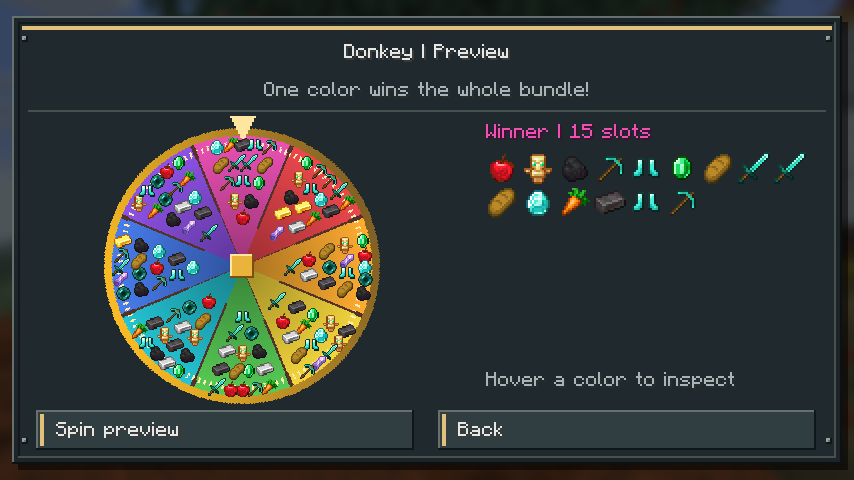

# PureFix

PureFix is an English-only, **client-side Fabric mod for Minecraft Java 26.3**. It helps multiplayer staff teleport from InventoryRollbackPlus backups and recover their position after disconnecting while spectating, and draw random occupied inventory slots with Donkey.


## Guide

- [Install PureFix](#installation)
- [Draw inventory bundles with Donkey](#donkey)
- [Save servers and identify worlds](#server-saves)
- [Use EnderFix](#enderfix)
- [Use SpectateFix](#spectatefix)
- [Find and recover local data](#local-data-and-recovery)
- [Build from source on Windows 11](#build-from-source-on-windows-11)
- [Troubleshoot common problems](#troubleshooting)
- [Verify and contribute](#build-and-verification)

## Installation

1. Install Minecraft **26.3**, Fabric Loader **0.19.5 or newer**, and Java **25 or newer**.
2. Put `purefix-1.4.1.jar` in your Minecraft instance's `mods` folder. On a standard Windows launcher installation, this is `%APPDATA%\.minecraft\mods`; custom launchers may use a different instance folder. Remove the previous PureFix jar when upgrading; keep your configuration folder.
3. Install **Fabric API for 26.3**. This release was built with `0.161.0+26.3`.
4. Install **Mod Menu for 26.3** to access **Mods > PureFix > Configure**. This release was built with Mod Menu `21.0.0`. Mod Menu is optional: `/purefix` also opens the configuration while connected.
5. Connect to your multiplayer server. PureFix is not installed on the server.

Each feature uses the server tools relevant to it: EnderFix requires CoreProtect and InventoryRollbackPlus; SpectateFix requires CoreProtect plus the server's `/s` or `/spectate` command; Donkey requires an editable `/invsee` menu such as InvSee++. Your account needs the matching permissions. PureFix sends ordinary commands and inventory clicks using your account; it does not grant permissions or install server plugins.

## Donkey



Let fate pack the little donkey's chest! Open **Donkey** in the configuration menu, or run `/donkey <player>` in multiplayer. PureFix registers that client alias with Minecraft's command system and sends `/invsee <player>` to the server. Type `/donkey ` (with a trailing space) to see player-name suggestions, just as with other commands. Suggestions use the names available to your client; you can also type an offline name manually. Entering `/donkey` without a name shows usage instead of sending an incomplete command to the server. Editing the alias or toggling Donkey refreshes its command completions during the current connection. Upgrading migrates the previous `/shame {player}` and 2000 ms defaults once; customized values are preserved. You can subsequently choose either previous value again.

1. The default recognized title is `{player}'s Inventory`, matching the supplied five-row menu. Edit **Inventory title** for a different server title. Chest menus with one to six rows are supported.
2. **InvSee++ placeholder filter** defaults to ON. It removes items whose lore contains the exact line `InvSee++ placeholder`, ignoring formatting. This includes the colored pane placeholders and the plugin's alternative icon placeholders, while ordinary player-owned glass remains eligible. Turn the filter OFF in Donkey to include those marked items again. Review the captured inventory and click any remaining plugin controls to exclude them before spinning. Empty slots and your own inventory are excluded automatically; equipment slots shown by the plugin can participate.
3. Each colored sector contains a complete random bundle of **15 distinct occupied slots** by default. Sectors may share some items, but the same complete combination cannot appear twice, even in a different order or using equivalent stacks from different slots. Stack identity includes item components and count. All eligible stack contents are represented across the wheel. Normally there are up to eight sectors; small bundle sizes can require more to cover the inventory. If only one combination exists, the wheel has one sector.
4. Hover a color to inspect its full bundle. The wheel draws the items inside each sector; the side panel shows them at inventory size. Click **Spin & transfer** for one **8-second spin** that selects one color and its entire bundle. If fewer eligible slots exist than the configured bundle size, the single bundle contains all of them.
5. After the spin, the winning slots are moved to your inventory one at a time. Every item in each slot is taken: 64 diamonds in one slot count as one slot. The default interval is **300 ms after the previous transfer is confirmed**. Blank interval input restores 300 ms. Zero still waits for each server confirmation.

**Enable Donkey** and **Roulette sounds** default to ON. **Sound style: Dedsafio** uses the supplied roulette recording by default; switch to **Classic** for the previous Minecraft click/XP style. **Spin speed** accepts 1 to 2, including decimals: 1x = 8 seconds, 1.5x = about 5.33 seconds, and 2x = 4 seconds. Blank speed input restores 1x. Playback speed and pitch increase with the animation. Closing or cancelling the wheel stops its soundtrack. Acceleration does not change the transfer interval. A Minecraft level-up sound also confirms when all winning slots have finished transferring; **Roulette sounds: OFF** mutes that completion notice as well.

The menu also edits **Slots per color** (1-54), the client alias, the server command, and the inventory title. Both commands require `{player}`. **Preview roulette** uses the same duration, speed, and sound settings offline without moving items. The supplied sound's provenance and conversion are documented in [audio notes](docs/AUDIO.md).

The server must provide an editable invsee inventory and grant your staff account permission to take items. PureFix sends normal shift-click requests; it cannot bypass permissions. A changed winning item, full inventory, disconnect, closed menu, rejected/partial move, or missing server confirmation stops the queue. Completed transfers remain; an already-sent click may still finish after cancellation. Interrupted draws are never replayed on reconnect. Losing items are left untouched: Donkey does not clear the target's inventory or ban anyone.

The supplied video shows InvSee++ placeholders, but live transfers on your server have not been verified. Check the slot exclusions and try a test inventory before using Donkey for moderation. Automated queue tests and the offline client preview are covered in [verification notes](docs/TESTING.md).

## Server Saves

**Automatic server capture** is ON by default. PureFix stores the connected address, the server-list display name, a detected subserver identifier, editable subserver name, and dimension-to-Bukkit-world mappings. Display names initially come from the client server list, not the proxy's private configuration.

- **Add Server** captures the current multiplayer address and detected ID and asks for a subserver name. Saving selects that profile for the current connection.
- Open a profile to edit its name, address, or subserver, select it for this connection, edit world mappings, enable/disable automatic recovery, or delete it.
- **Bind to current detected ID** updates a profile after an identifier changes. Only do this while connected to that subserver.
- Deleting a profile suppresses its automatic recapture. **Allow deleted servers to be captured again** resets that suppression for future connections.
- Deleting a profile retains its saved recovery records. Remove those separately with **SpectateFix > Saved returns > Forget** if no longer needed.
- **Export server saves to CSV** writes one row per world mapping to `config/purefix/servers.csv`. CSV is an export, not the authoritative database.

Turning off passive automatic capture stops discovery. **Add Server** remains available. Starting a spectate session may create a return profile when no matching profile exists, because saving the return requires a server identity.

### Proxy networks and identification limits

PureFix prioritizes world IDs received on **`xaeroworldmap:main`**, the Xaero World Map channel supported by MapModCompanion. Xaero World Map does not have to be installed on the client. When it is installed, PureFix observes its packets without replacing its decoder or receiver. No other map channels are registered.

Open **SpectateFix > Check MapModCompanion** while connected to print the current detection result in Minecraft chat. A valid message confirms a compatible world-ID provider, **not the exact plugin name**: other software can send the same protocol. No message does not prove the plugin is absent. This button reports received data; it does not send a plugin-list command or request.

On a previously unknown network, PureFix waits **60 client ticks** (about three seconds) for world data before falling back to the vanilla server-provided obfuscated seed fingerprint. A valid Xaero ID takes priority when it arrives. Once an address has supplied a valid ID, that fact is persisted: future missing IDs keep recovery pending instead of silently downgrading to seed detection. World transitions clear the previous confirmed ID, including transitions with an identical seed. Spectate entry is blocked while identity is unresolved.

The vanilla fallback is a heuristic. Cloned worlds/backends can share an identifier; servers can hide it; regenerated worlds may change it. It does not reveal the private world seed. For hidden or shared fallback identifiers:

1. Use **Add Server** to create each subserver profile and give it a useful name.
2. Use **Use this subserver for this connection** when entering that backend. Selection resets on disconnect, login/respawn, or a changed detected ID. Manual selection cannot override a conflicting Xaero ID.
3. When several profiles have the same address and identifier, PureFix does not automatically choose one. A zero/hidden identifier also requires manual selection before automatic recovery.
4. For a backend whose identity cannot be trusted, turn **Automatic spectate recovery** OFF in its profile until you select the correct backend and enable recovery.

Xaero IDs identify **worlds**, not necessarily whole SMP backends. Different dimensions can have different IDs, and the packet supplies neither a human SMP name nor a Bukkit world name. Profiles are separated by main address and detected ID. A return saved with a Xaero ID waits for **that exact ID**, even if another world belongs to the same SMP. PureFix does not infer that two IDs share a backend, switch servers, or treat a changed inventory as proof of identity. A misconfigured provider that reuses IDs can still cause collisions.

Upgrading preserves existing profiles and returns. Seed profiles are not automatically merged with new Xaero profiles, because matching seeds are not proof of the same world. Use **Bind to current detected ID** only after verifying the world; resolve duplicate profiles manually. PureFix neither reads nor modifies Xaero files. See [design notes](docs/DESIGN.md).

### Bukkit world mappings

Each profile starts with:

| Minecraft dimension | CoreProtect/Bukkit world |
| --- | --- |
| `minecraft:overworld` | `world` |
| `minecraft:the_nether` | `world_nether` |
| `minecraft:the_end` | `world_the_end` |

These are conventional names, not server-verified names. Change them under **World mappings** for renamed worlds, Multiverse worlds, or custom dimensions. Custom dimension IDs must be mapped before spectating. Names must be a single command-safe token; spaces are not supported. A backup pearl supplies its own world name, so EnderFix does not substitute these mappings for the pearl's world.

## EnderFix

Enabled by default, with a small vanilla ender pearl icon and teleport sound.

1. Run `/ir restore <player>`, `/irp restore <player>`, or `/inventoryrollback restore <player>`.
2. PureFix watches for the **Player Data** 9-slot menu. It checks the empty slots and bone, oak sapling, red bed, compass, and diamond; the first slot is deliberately ignored.
3. Navigate to **Main Inventory Backup**.
4. Left- or right-click the teleport pearl in the bottom action row (slot 49, counted from zero).
5. PureFix reads `World:`, `X:`, `Y:`, and `Z:` from the pearl's lore, closes the container, cancels the original inventory click, and sends:

```text
/co teleport #{world} {x} {y} {z}
```

For the supplied screenshot the command is:

```text
/co teleport #world_nether -145.6 128 308.7
```

The screenshot's Z value is **308.7**; it is not rounded to 309. Formatting codes are removed before parsing. Negative and decimal coordinates are supported. Duplicate, missing, nonnumeric, out-of-range, or unsafe fields are rejected. Modified clicks on the recognized action pearl are cancelled to prevent a second plugin action.

**EnderFix settings** include enable/disable, sound, adding/editing/deleting restore command patterns, the teleport command, and exact menu/item recognition titles. All four placeholders `{world}`, `{x}`, `{y}`, `{z}` are required. Literal `x y z` is not a valid template. The lore labels remain English; translated/custom lore layouts need a code adapter.

**Restore command patterns > Reset > Confirm** restores exactly these defaults:

```text
/ir restore {player}
/irp restore {player}
/inventoryrollback restore {player}
```

Upgrading from the untouched 1.0.0 default list adds the new alias automatically. Customized lists are preserved until you explicitly reset them.

The initial menu must appear within two minutes of a recognized command. After it is recognized, the menu chain remains armed for up to ten minutes; closing it disarms detection after a short transition allowance. Opening a backup through an unrelated command or bypassing the initial menu does not arm EnderFix. No ordinary inventory pearl is intercepted.

Vanilla ender pearl teleportation uses the Enderman teleport sound, so EnderFix uses that sound locally when it dispatches the command. Sound is not proof that the server accepted the teleport.

## SpectateFix

Enabled by default, with Enderman teleport sound. Its menu icon uses your current player's skin face while in-game, with Steve as the offline fallback. Menus use vanilla item artwork, pixel borders, colored section accents, and explicit ON/OFF badges.

1. Stand at your return point, for example `world_nether`, `0 90 0`.
2. Run `/s <player>` or `/spectate <player>`.
3. PureFix writes the original position to disk **before sending the command**. If it cannot safely save, it cancels the spectate command and tells you why.
4. PureFix watches server game-mode changes. Once spectator mode has been observed for the saved session, a server change to survival, creative, or adventure clears the return. This also covers the observed player disconnecting when your server responds by returning you to survival. Repeating spectate commands preserves the original position; bare `/s` and `/spectate` pass through without clearing anything.
5. If you disconnect, crash, or close Minecraft before that exit is observed, the return remains on disk. Reconnect to the matching world. PureFix waits for world identification and the initial server position, plus a configurable readiness delay (default **0 ticks**), then sends:

```text
/co teleport #world_nether 0 90 0
```

Return records are separated by **player UUID and server profile**. A new spectate session in the current connection does not immediately trigger recovery. The mod sends at most one automatic attempt per pending return per connection. For automatic recovery, it confirms arrival after a new server position update places the player within two blocks of the stored coordinates in the stored dimension and matching profile. The sound plays when arrival is confirmed. An observed normal exit from spectator mode can also clear a saved session without issuing a recovery command.

If no arrival is confirmed within ten seconds, the record remains. Use **SpectateFix > Saved returns > Retry** after logging in or fixing permissions/mappings. **Forget** permanently discards a record after confirmation. Disabling SpectateFix preserves existing saved returns.

You can edit entry patterns, the teleport template, delay, and sound. Patterns match the whole command; `{player}` matches one player-name token. Aliases must be listed separately. Exit command patterns were removed in 1.2.0. An older configuration's 10-tick default migrates to 0; other delays are preserved. You can subsequently set any delay from 0 to 1200 ticks.

The mode detector is **event-driven**: it reads Minecraft's local game mode after the server's mode-change packet is applied. F1 and whether the spectator menu is open do not affect it. It does not scan inventory items or the rendered screen, and needs no three-second polling interval. Login, disconnect, and respawn alone never count as exit confirmation.

**MapModCompanion detection** is ON by default. Turn it OFF in SpectateFix to use the seed fallback immediately, without waiting for map announcements. Previously observed profiles can use their stored seed association; ambiguous or hidden seeds require manual selection. With detection OFF, exact Xaero-ID checking is disabled, but account, profile, position, and recovery guards remain. Existing Xaero profiles without a known seed association may require manual selection. This is less reliable on networks with shared seeds. The switch affects the world identity used by Server Saves as well as SpectateFix; it does not disable the server plugin.

When an initial spectate entry is blocked waiting for an ID, the English chat message points to this setting and plays the villager's negative-response sound. Commands during an already tracked session or while already in spectator mode pass through even while identity is unresolved, so staff can exit or change targets. Starting while already in spectator mode does not create a new origin.

### Server-specific behavior

- PureFix observes commands and game-mode updates, not the server plugin's internal state. A rejected entry command still leaves a saved return. Use **Forget** if necessary. Repeated commands do not replace that original position.
- Automatic exit detection requires an actual spectator-to-other-mode update. A plugin that only swaps inventory items or cameras without changing game mode cannot provide this signal. An unrelated game-mode change during a tracked spectator session also counts as an exit. Coordinates alone are not used as proof of exit.
- Authentication plugins, a hub before backend connection, and anti-teleport rules can delay/reject the return. Increase the delay or Retry after login. Automatic retry loops are deliberately avoided.
- CoreProtect may adjust the destination for safety. An adjustment beyond the two-block arrival tolerance leaves the return pending; inspect the result and use Forget if appropriate. Yaw/pitch and game mode are not changed or restored.
- Full coordinate precision is stored locally. Commands use up to three decimal places (fewer near the world border) to fit CoreProtect's coordinate-token length limit.

## Local data and recovery

```text
config/purefix/purefix.json       Settings, server profiles, pending returns
config/purefix/purefix.json.bak   Previous successful save
config/purefix/servers.csv       Optional server export
```

JSON supports named records, dimension maps, settings, and recovery state without fragile CSV relationships. Saves force the new file to disk and replace the original atomically when the filesystem supports it. There is no per-tick disk writing: changes, captured identities, and recovery transitions trigger writes.

If the JSON is malformed or uses an unsupported schema, PureFix preserves it, reports an error, and disables storage-dependent automation. To recover: close Minecraft, copy the damaged file somewhere safe, restore `purefix.json.bak` as `purefix.json` or repair the JSON, and restart. Edit data only while Minecraft is closed. Use a separate game directory per running client; concurrent writers to the same configuration are unsupported.

The data includes server addresses, player UUIDs, and staff return locations. Keep it local when sharing screenshots or modpacks. PureFix has no telemetry or external service.

## Build from source on Windows 11

1. Download this repository with **Code > Download ZIP** on GitHub, or clone it with Git. Extract it to a normal folder. Keep the `gradle/wrapper` directory and both `gradlew` files.
2. Install **JDK 25**. Open PowerShell inside the extracted project folder. Check that `java -version` reports Java 25, or set `JAVA_HOME` to your JDK 25 folder. For example, if that folder exists on your computer:

   ```powershell
   $env:JAVA_HOME = 'C:\Program Files\Java\jdk-25.0.4'
   ```

3. Build the mod with the included Gradle wrapper:

   ```powershell
   .\gradlew.bat clean build
   ```

4. Install **`build/libs/purefix-1.4.1.jar`** in your Minecraft instance's `mods` folder. The `-sources.jar` is for reading source code and is not an installable mod. Install Fabric API and, if you want the Mods configuration button, Mod Menu as described in [Installation](#installation).

The first build needs an internet connection to download Gradle and the Minecraft/Fabric dependencies. Windows PowerShell accepts the commands above as written; Command Prompt uses `gradlew.bat clean build` without `./` or `.\`. GitHub's downloaded project ZIP is source code, while the release `.jar` is the installable mod.

## Troubleshooting

| Symptom | Check |
| --- | --- |
| `/donkey` previously showed “Unknown or incomplete command” | Install the latest PureFix jar, remove older PureFix jars, and reconnect. Enter `/donkey ` with a trailing space to see online names; type an offline name yourself. `/donkey` alone displays usage. |
| `/donkey <player>` does not open an inventory | Confirm your account can run `/invsee <player>` on that server and that **Donkey > Server command** matches its command. |
| “Inventory not recognized” | Set **Donkey > Inventory title** to the server's exact inventory title, keeping `{player}`. |
| InvSee++ colored panes appear on the wheel | Turn **InvSee++ placeholder filter** ON. It recognizes the plugin's `InvSee++ placeholder` lore line. Click other plugin control items in the review screen to exclude them. |
| “No eligible inventory items” | The visible contents are empty or all marked placeholders. Turn the filter OFF only if you deliberately want those marked items included. |
| A winning stack does not transfer | Check InvSee++ edit permission and space in your own inventory. PureFix stops after a rejected, changed, partial, or unconfirmed move; inspect both inventories before another draw. |
| No roulette or completion sound | Turn **Roulette sounds** ON and check Minecraft's sound volume. Choose **Dedsafio** or **Classic** under **Sound style**. |
| Build fails before downloading dependencies | Check your connection and use JDK 25 or 26. Gradle 9.6.0 in this project cannot run on JDK 27. |

## Build and verification

Use JDK 25 (tested) or JDK 26; the wrapper downloads Gradle 9.6.0. Set `JAVA_HOME` explicitly if your default Java is 27, which this Gradle version cannot run on.

```powershell
# Optional after building: run automated tests and the development client.
.\gradlew.bat test
.\gradlew.bat runSmokeClient
```

On Linux/macOS use `./gradlew clean build`. Output: `build/libs/purefix-1.4.1.jar`. The `-sources.jar` is source code, not the installable mod. `runSmokeClient` opens a development Minecraft client, checks menu navigation, Reset, packet observation, and mixin loading, saves screenshots in `run-smoke/screenshots`, and exits. The separate smoke-test mod is not included in the release jar.

Automated tests cover parsing, command validation, persistence/restart, corruption handling, export, and recovery gating. See [testing notes](docs/TESTING.md) for the real-server acceptance checklist and verification limits.

## Project references

- [Fabric 26.3 migration notes](https://fabricmc.net/2026/09/15/263.html)
- [InventoryRollbackPlus source](https://github.com/TechnicallyCoded/Inventory-Rollback-Plus)
- [CoreProtect teleport implementation](https://github.com/PlayPro/CoreProtect/blob/master/src/main/java/net/coreprotect/command/TeleportCommand.java)
- [Xaero's Minimap documentation](https://www.curseforge.com/minecraft/mc-mods/xaeros-minimap)
- [MapModCompanion protocol documentation](https://github.com/turikhay/MapModCompanion/wiki/How-it-works)

MIT licensed. PureFix is an independent project, not affiliated with Mojang, Fabric, Xaero, CoreProtect, or InventoryRollbackPlus.
